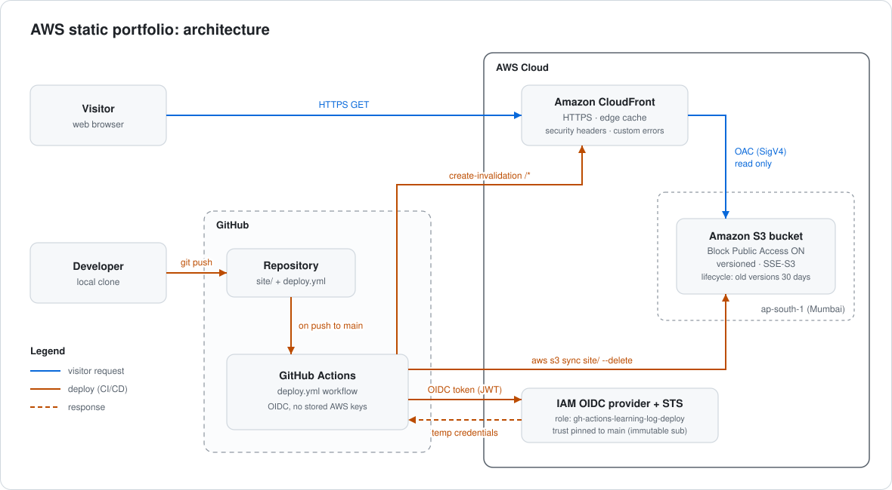

# AWS Static Portfolio: S3 + CloudFront + GitHub Actions (OIDC)

A static site hosted on a **private** S3 bucket, served globally through **CloudFront** with Origin Access Control, and deployed automatically on every push to `main` by **GitHub Actions using OIDC**. No AWS access keys are stored anywhere.

**Live:** https://d1p6yrpzt1uwnz.cloudfront.net

Built as hands-on practice for the AWS Certified Solutions Architect – Associate exam.

---

## Architecture



| Layer | Service | Purpose |
|---|---|---|
| Storage | Amazon S3 (ap-south-1) | Private origin, versioned, encrypted |
| Delivery | Amazon CloudFront | HTTPS, edge caching, custom errors, security headers |
| Access control | Origin Access Control (OAC) | Only this distribution can read the bucket |
| CI/CD | GitHub Actions | Sync + cache invalidation on push |
| Identity | IAM OIDC provider + role | Keyless, short-lived credentials per run |

---

## Security design

### Private origin
- **S3 Block Public Access** is fully enabled. The bucket has no public endpoint.
- **Origin Access Control:** CloudFront signs its requests to S3 with SigV4. The bucket policy allows `cloudfront.amazonaws.com` only, with an `AWS:SourceArn` condition scoped to this one distribution. Other distributions, even in the same account, can't read the bucket.
- The origin uses the S3 **REST endpoint**, not the static-website endpoint, which can't be used with OAC.

### Edge
- HTTPS by default with the CloudFront certificate; HTTP redirects to HTTPS.
- Managed **SecurityHeadersPolicy** response headers policy adds `Strict-Transport-Security`, `X-Content-Type-Options: nosniff`, `X-Frame-Options`, `Referrer-Policy` and `X-XSS-Protection`.
- **Custom error responses:** both `403` and `404` map to `/error.html` with a `404` status. A private bucket returns 403 for missing keys, so mapping only 404 would leak raw S3 errors.

### CI/CD: keyless deployment with OIDC
- GitHub Actions requests an OIDC token, and AWS STS exchanges it for temporary credentials (about 1 hour) via `AssumeRoleWithWebIdentity`.
- **No long-lived secrets:** no IAM user and no access keys in GitHub.
- **Trust policy pinned to the `main` branch** using GitHub's immutable subject claim format, which includes numeric owner and repo IDs so a recycled username or repo name can't match:

  ```json
  "StringEquals": {
    "token.actions.githubusercontent.com:aud": "sts.amazonaws.com",
    "token.actions.githubusercontent.com:sub": "repo:<owner>@<owner-id>/<repo>@<repo-id>:ref:refs/heads/main"
  }
  ```

- **Least-privilege permissions policy:** only what `s3 sync --delete` and one invalidation need.

  ```json
  {
    "Version": "2012-10-17",
    "Statement": [
      { "Effect": "Allow", "Action": "s3:ListBucket",
        "Resource": "arn:aws:s3:::<bucket>" },
      { "Effect": "Allow", "Action": ["s3:PutObject", "s3:DeleteObject"],
        "Resource": "arn:aws:s3:::<bucket>/*" },
      { "Effect": "Allow", "Action": "cloudfront:CreateInvalidation",
        "Resource": "arn:aws:cloudfront::<account-id>:distribution/<distribution-id>" }
    ]
  }
  ```

- Workflow hardening: `permissions` limited to `id-token: write` and `contents: read`, `persist-credentials: false` on checkout, values passed through `env:` rather than interpolated into shell scripts, `concurrency` to prevent overlapping deploys, and `role-session-name` set to the run ID so every deploy is traceable in CloudTrail.
- Only the `site/` folder is synced, so `README.md`, workflow files and `.git/` never reach the bucket.

### Data protection
- **Versioning** enabled. Any bad deploy can be rolled back to a previous object version.
- **Default encryption** with SSE-S3.
- **Lifecycle rule:** noncurrent versions expire after 30 days and incomplete multipart uploads are aborted after 7 days, so old versions don't accumulate cost.

---

## Repository layout

```text
.
── .github/workflows/deploy.yml   # OIDC deploy pipeline
├── docs
|   ├──architecture.svg           # architecture diagram
├── site/
│   ├── index.html ├                # learning-log page
│   └── error.html                 # custom 403/404 page
└── README.md
```

The workflow only triggers on changes under `site/**` or to the workflow itself, so README edits don't cause a deploy.

---

## Deployment pipeline

On every push to `main` that touches `site/`:

1. Check out the repo.
2. Assume `gh-actions-learning-log-deploy` via OIDC.
3. `aws s3 sync site/ s3://<bucket> --delete`
4. `aws cloudfront create-invalidation --paths "/*"`

It can also be run manually from the Actions tab (`workflow_dispatch`).

---

## Verification

| Check | Command / action | Result |
|---|---|---|
| Bucket is private | Open the S3 object URL directly | `AccessDenied` |
| Site served via CloudFront | Open the `cloudfront.net` URL | Page loads over HTTPS |
| Custom error page | Request a non-existent path | Custom error page with 404 status |
| Security headers | `curl -I https://d1p6yrpzt1uwnz.cloudfront.net` | HSTS, nosniff, X-Frame-Options, Referrer-Policy present |
| Edge caching | Run `curl -I` twice | `Miss from cloudfront`, then `Hit from cloudfront` |
| Auto-deploy | Edit the footer, push to `main`, curl the site | New footer live after invalidation |

<!-- Add screenshots to docs/ and link them here, e.g.


-->

---

## Lessons learned

**GitHub's immutable OIDC subject claim (2026).** The first deploys failed with `Not authorized to perform sts:AssumeRoleWithWebIdentity`, even with a broad `repo:<owner>/*` wildcard in the trust policy. Repositories created after 15 July 2026 use a new default `sub` format that appends numeric IDs: `repo:<owner>@<owner-id>/<repo>@<repo-id>:ref:refs/heads/main`. Because the `@<id>` sits between the owner name and the `/`, the old-style wildcard never matched. The fix was to copy the exact prefix from **Repo → Settings → Actions → OIDC** and pin the trust policy to it with `StringEquals`. Many existing tutorials still show the old format.

**403 vs 404 from a private bucket.** S3 returns 403, not 404, for missing keys when the caller can't list the bucket, so both codes need a custom error response.

---

## Cost

Effectively a few cents a month at portfolio traffic levels: S3 storage for two small files, CloudFront data transfer, and invalidations (the first 1,000 paths per month are free; `/*` counts as one path). No NAT gateways, load balancers or always-on compute.

---

## Future work

- **Custom domain:** ACM certificate in `us-east-1` (CloudFront only reads certificates from that region), alternate domain name on the distribution, and Route 53 Alias A/AAAA records. Subdomain delegation would let the domain stay with an external registrar.
- Pin GitHub Actions to full commit SHAs for supply-chain hardening.
- Add a branch-protection rule on `main` and a negative test proving other branches can't assume the role.
- CloudFront standard logging or CloudWatch alarms on 4xx/5xx rates.
- Define the whole stack as code (Terraform or CloudFormation).